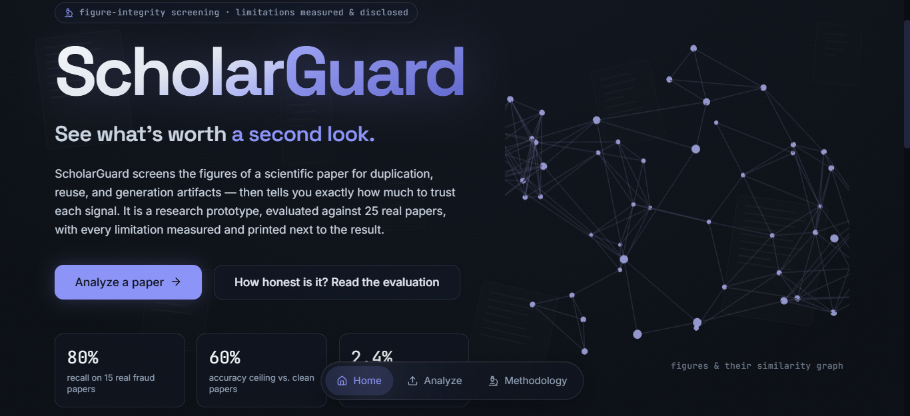
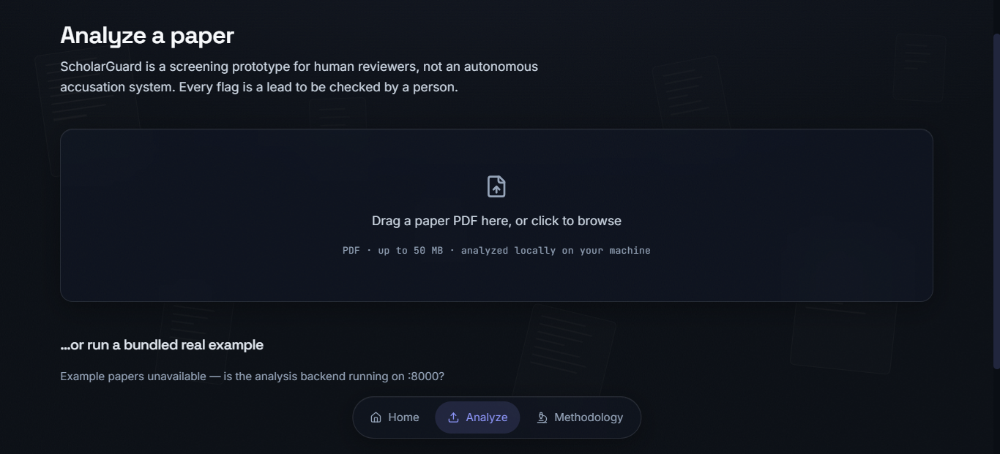
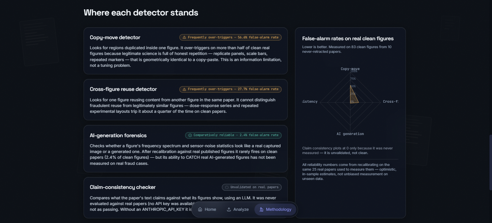
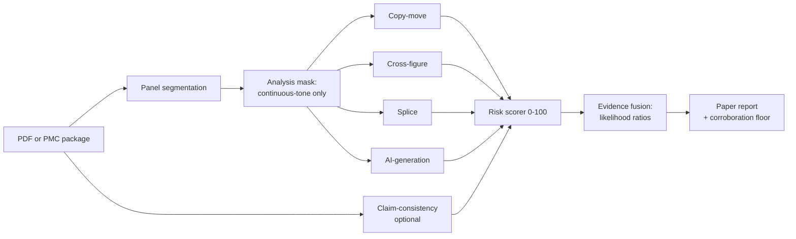
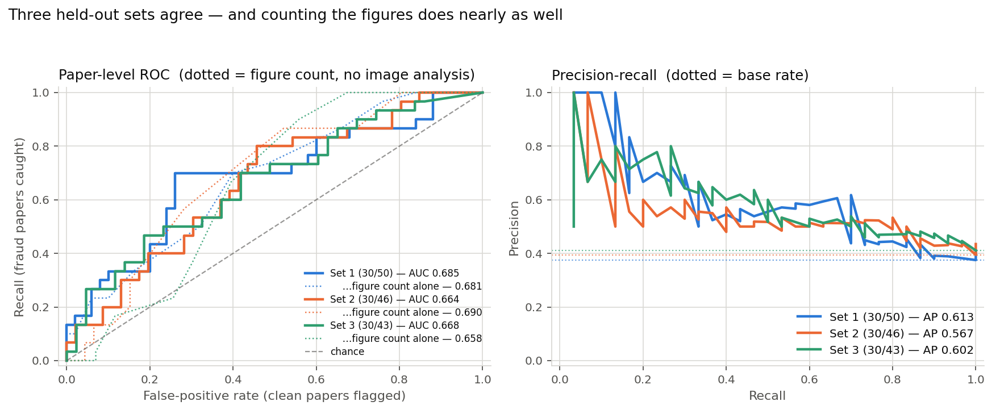
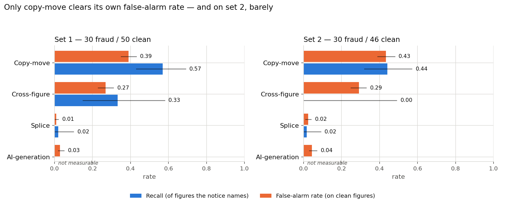

# ScholarGuard

<p align="center">
  <a href="ScholarGuard%20Demo.mp4">
    
  </a>
  <br>
  <sub>▶ <b><a href="ScholarGuard%20Demo.mp4">Watch the ScholarGuard demo</a></b> (74 s): the eight-stage roadmap, the twelve-stage evaluation, 111 commits, CI, then twelve live steps on real retracted and clean papers</sub>
</p>

**Figure-integrity screening for scientific papers — with every limitation measured and disclosed.**

[](https://github.com/guru-bharadwaj20/ScholarGuard/actions/workflows/tests.yml)
[](pyproject.toml)
[](web/package.json)
[](tests)
[](EVALUATION.md)
[](EVALUATION.md)
[](LICENSE)

ScholarGuard screens a paper's figures for duplication, cross-figure reuse,
splicing and AI-generation artifacts, then checks the text's claims against the
figures. It surfaces leads for a human reviewer — and tells you exactly how much
to trust each one.

**The evaluation is the point of the project.** Detectors are easy to write and
easy to fool yourself about. Most of the work went into measuring how often each
one is wrong, on real retracted papers, and into withdrawing the improvements
that did not replicate.



---

## Contents

| Section | |
|---|---|
| [What it does](#what-it-does) | Detectors, scoring and the web app |
| [Architecture](#architecture) | Segment, mask, detect, score, fuse |
| [How a paper is screened](#how-a-paper-is-screened) | From PDF to report |
| [Results](#results) | Three held-out sets, and the confound that matters |
| [Quick start](#quick-start) | CLI, Docker, web app |
| [Project status](#project-status) | What is measured, what is not, and what CI proves |
| [Design decisions](#design-decisions) | The ideas doing the heavy lifting |
| [Repository layout](#repository-layout) | Where things live |
| [Documentation](#documentation) | Which file answers which question |
| [Team](#team) | Who built it |

---

## What it does

| Detector | Signal | Technique |
|---|---|---|
| **Copy-move** | Regions duplicated within one figure | Content-gated SIFT + g2NN + RANSAC + ZNCC region growing + noise-residual clone test, with a dense-field block-DCT tier for smooth blots SIFT misses |
| **Cross-figure** | One figure reusing another | pHash + CNN embeddings + FAISS + geometric verification + clone test, with publisher-furniture filtering |
| **Splice** | A region pasted from another source | Noise inconsistency + JPEG-ghost/ELA, flagged only where a foreign noise level *and* a foreign compression fingerprint agree |
| **AI-generation** | GAN/diffusion artifacts | FFT spectral falloff + azimuthal anisotropy + PRNU wavelet residual, conditioned on JPEG compression (optional CNN) |
| **Claim-consistency** | Text claims vs figure content | PDF parsing + Claude API structured extraction + multimodal figure observation (optional) |

| Area | Capabilities |
|---|---|
| **Inputs** | A PDF or a PubMed Central package |
| **Scoring** | A transparent 0–100 fixed-weight risk score, plus a likelihood-ratio evidence layer |
| **Paper decision** | Led by corroboration: a figure two or more independent detectors flag lifts the paper to at least "high" |
| **Reports** | JSON + Markdown per paper, with what was skipped and why |
| **Web app** | Upload or run a bundled real example; live progress over SSE; score breakdown, calibrated evidence, reliability badges, triage and downloads |
| **Evaluation** | Benchmark runner, Wilson CIs, ROC/PR, LOOCV, error analysis, offline recalibration |
| **Data** | Acquisition scripts for PMC Open Access and Retraction Watch |

<p align="center">
  
  
</p>

---

## Architecture



Everything runs CPU-only except the optional AI classifier, which trains on a
GPU and infers on CPU. The web app is a Next.js 14 front end over a thin FastAPI
bridge with zero pipeline logic.

---

## How a paper is screened

```mermaid
sequenceDiagram
    participant U as Reviewer
    participant W as Web app / CLI
    participant P as Pipeline
    participant D as Detectors
    participant L as Claude API (optional)
    participant R as Report

    U->>W: upload PDF
    W->>P: run (queued; 503 beyond the queue depth)
    P->>P: extract figures, segment panels, build the analysis mask
    P->>D: copy-move · cross-figure · splice · AI-generation
    D-->>P: findings with confidence, scaled by the clone test
    opt ANTHROPIC_API_KEY set
        P->>L: extract claims, observe figures
        L-->>P: claim-consistency findings
    end
    P->>P: 0–100 score, likelihood-ratio evidence, corroboration floor
    P->>R: JSON + Markdown
    W-->>U: live progress over SSE, then the full report
```

---

## Results

Measured on **three independent held-out sets** of real PubMed Central papers —
30 formally retracted image-fraud papers each, against 50, 46 and 43 clean
controls, with no overlap between sets or with anything used for tuning.



| | Set 1 (30/50) | Set 2 (30/46) | Set 3 (30/43) |
|---|---|---|---|
| ROC-AUC (0.5 = chance) | 0.685 | 0.664 | 0.668 |
| **…with figure count controlled** | **0.571** | **0.632** | **0.625** |
| *Figure count alone, no image analysis* | *0.681* | *0.690* | *0.658* |
| Average precision | 0.613 | 0.567 | 0.602 |
| Precision / recall at the cutoff | 0.60 / 0.70 | 0.52 / 0.77 | 0.53 / 0.60 |

It finds roughly **6–8 in 10 known-fraud papers** while flagging **28–47% of
clean ones** — a triage aid, not a verdict machine.

**Read rows 2 and 3 together.** Retracted papers simply have more figures
(median 7.5 vs 5.0), so counting them predicts retraction about as well as the
whole pipeline does. Comparing only papers with an *identical* figure count,
the ranking pooled across all three sets is **0.610 (95% CI 0.482–0.725, 439
matched pairs)**: probably real signal, roughly a fifth as strong as the raw
number suggests, and still not separable from chance. Every evaluation run
prints this control.

### Per detector



Copy-move has the clearest sensitivity, replicated three times: it catches about
**half** the figures a retraction notice names (0.57 / 0.44 / 0.59).
Cross-figure lands at 0.33 / 0.00 / 0.31, splice at 0.02 on every set.
AI-generation recall is unmeasurable — no notice in any set describes a figure
as generated. **Across all three sets, every detector's recall interval overlaps
its own false-alarm interval**; copy-move comes closest and does not manage it.

### Findings worth more than the metrics

| | |
|---|---|
| 🎯 **The headline metric was measuring the wrong thing** | Paper-level ROC-AUC could not distinguish this pipeline from `len(paper.figures)`. Found by benchmarking against the dumbest possible predictor; now a permanent line in every report |
| 📉 **An "improvement" that did not replicate** | A trained AI classifier lifted set 1 from 0.685 → 0.733. On set 2 it was the *worst* of three configurations, with triple the false-alarm rate. Disabled by default |
| 🔧 **A threshold, not a model** | Most of that apparent gain was reproducible by a two-line threshold change with no classifier at all |
| 🔁 **One held-out set is not enough** | The same detector's false-alarm rate moved 1.4% → 5.4% between sets with no code change |

---

## Quick start

> Rebuilding the corpora or training the optional classifier? See
> [DATASETS.md](DATASETS.md). This is the screening path.

```bash
# 1 — install and screen one paper
pip install -r requirements.txt              # Python >= 3.10
export ANTHROPIC_API_KEY=sk-ant-...          # optional — enables claim-consistency
python run_scholarguard.py --pdf path/to/paper.pdf

# 2 — tests and a CPU-only image (datasets mounted, not baked)
pytest -q                                    # 351 passed, 1 skipped
docker build -t scholarguard .

# 3 — the web app: API bridge on :8000, front end on :3000
pip install -r server/requirements.txt
uvicorn server.main:app --port 8000
cd web && npm install && npm run dev
```

Without an API key it still runs every image forensic and reports what it
skipped. All behaviour lives in [src/config/config.yaml](src/config/config.yaml).
The API key is read from the environment and never hardcoded.

---

## Project status

The pipeline, the web app and the three-set evaluation are complete. What is
**not** yet measured is stated as plainly as what is:

| Item | Status |
|---|---|
| Copy-move, cross-figure, splice, AI-generation | ✅ implemented, evaluated on three held-out sets |
| Figure-count confound | ✅ controlled and printed in every run |
| Trained AI classifier | ⏸ built, did not replicate, disabled by default |
| Conformal + Benjamini–Yekutieli count correction | ⏸ built and measured, declined — ranks worse than the confound it removes |
| Noisy-OR posterior as the headline | ⏸ measured, declined — a set-1 win that did not replicate |
| Claim-consistency | ⚠️ implemented and unit-tested against a mocked LLM, **never scored on a real paper** — skipped on all 1,475 figures while holding 10 of 100 risk points |

### What CI proves on every push

| Job | Proves |
|---|---|
| `pytest` | The suite passes — 351 tests across preprocessing, detectors, forensics, pipeline, evaluation and NLP |

---

## Design decisions

**Content gating.** Scientific figures are collages, and repeated axis labels,
tiled markers and identical scale bars are *geometrically identical to forgery*.
[panel_segmentation.py](src/preprocessing/panel_segmentation.py) splits each
figure by recursive X-Y cut, types every panel, and builds an analysis mask of
continuous-tone panels minus text and scale bars. The matchers only ever see that
mask.

**A noise-residual clone test.** ZNCC answers "do these regions *look* alike?" —
true for a copy-paste and for two honest replicate blots.
[residual_similarity.py](src/forensics/residual_similarity.py) asks whether the
two regions share **one exposure's sensor-noise field**. A genuine look-alike
scores ≈0 residual correlation; a true clone carries its noise with it. Heavy
JPEG that destroys the residual returns *inconclusive*, never a false
"independent".

**Likelihood ratios beside the fixed weights.** The 0–100 score explains *what*
fired. [evidence_fusion.py](src/pipeline/evidence_fusion.py) combines detectors
by calibrated likelihood ratios, so a detector that fires nearly as often on
clean papers as on fraud contributes ≈0 automatically. Shipped defaults are
deliberately weak so an uncalibrated install cannot over-claim.

**Lead with corroboration.** A figure two independent detectors agree on is real
evidence; a paper full of lone single-detector fires, which merely compound
across many figures, is not.

**Benchmark against the dumbest predictor.** Figure count alone is a permanent
row in every report, because a metric that cannot beat it is not measuring the
detectors.

**Show everything, including what was skipped.** The web app names every
detector alongside its measured false-alarm rate and recall, and "skipped" is
reported as information, not hidden.

---

## Repository layout

```
.
├── src/
│   ├── preprocessing/   panel segmentation, content typing, text/scale-bar masking
│   ├── detectors/       copy-move (+ dense-field tier), cross-figure, splice, AI-generation
│   ├── forensics/       frequency, noise residual, clone test, JPEG blockiness
│   ├── pipeline/        orchestrator, risk scorer, evidence fusion, report builder
│   ├── evaluation/      benchmark runner, metrics, error analysis, recalibration, conformal inference
│   ├── nlp/             PDF parser, PMC-package ingestion, claim/vision extraction
│   ├── config/          config.yaml — every detector knob
│   └── utils/           image I/O, torch thread policy, synthetic data
├── server/              FastAPI bridge (thin transport)
├── web/                 Next.js 14 + Tailwind + Framer Motion + Recharts + react-three-fiber
├── scripts/             data acquisition (PMC Open Access, Retraction Watch)
├── data/                corpora, evaluation sets, synthetic and sample cases
└── tests/               pytest suite
```

---

## Documentation

| Question | File |
|---|---|
| *How well does it work, stage by stage, including what was withdrawn?* | [EVALUATION.md](EVALUATION.md) |
| *How are the corpora rebuilt and annotated?* | [DATASETS.md](DATASETS.md) |
| *Which knobs control each detector?* | [src/config/config.yaml](src/config/config.yaml) |

---

## Team

| Member | Focus |
|---|---|
| **Guru R Bharadwaj** | Detectors and forensics, scoring and fusion, evaluation, web app |

---

## License

[MIT](LICENSE).

*Flags are leads for human review, not proof of misconduct. ScholarGuard analyzes figures locally; the Claude API is used only for optional text and claim extraction.*
